# Modern theme for Dolibarr

A modern, clean theme forked from `md`. Same markup and same compatibility as the standard theme, with a refreshed look, a configurable accent color and a dark mode.

## Screenshots

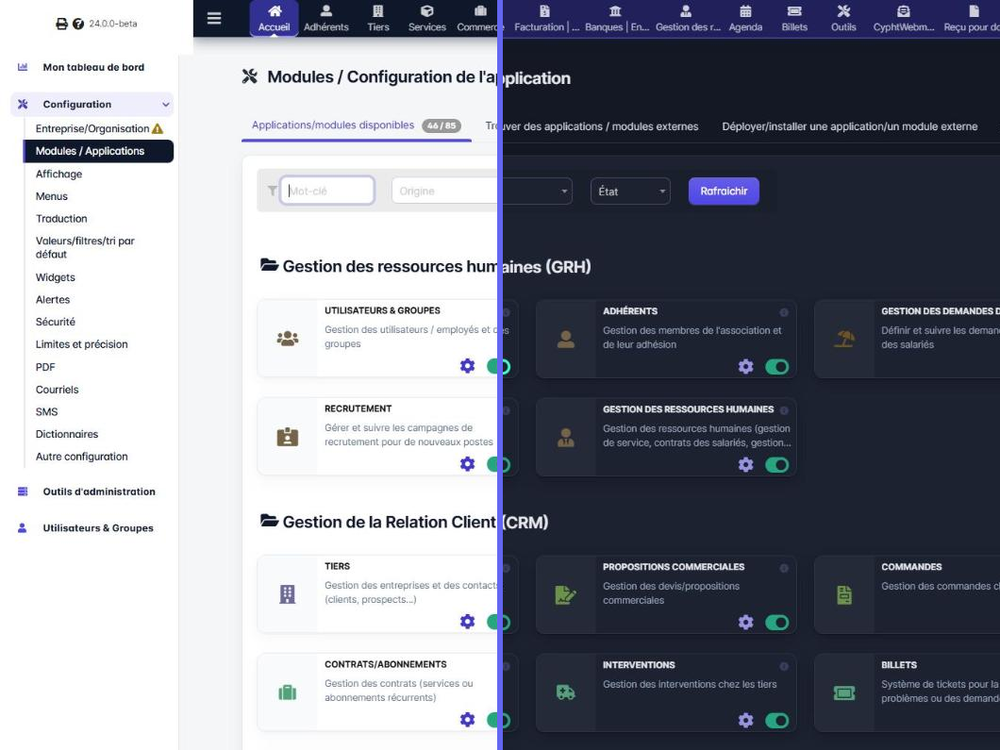

The picture above is also the preview shown in *Setup > Display > Theme* (`thumb.png`, 320x240). Below, the same pages in light and in dark.

| Light | Dark |
| --- | --- |
| 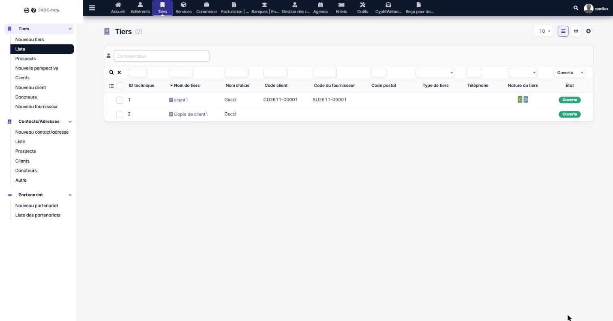 | 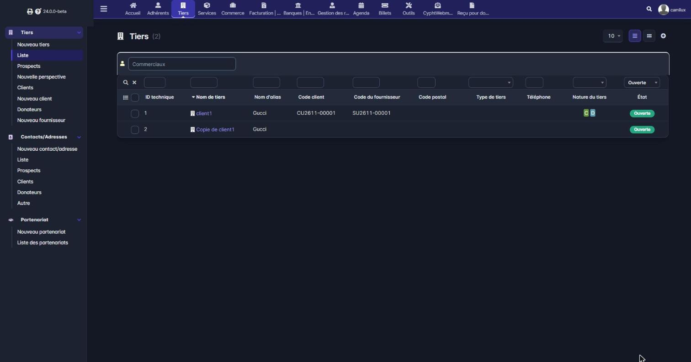 |
| 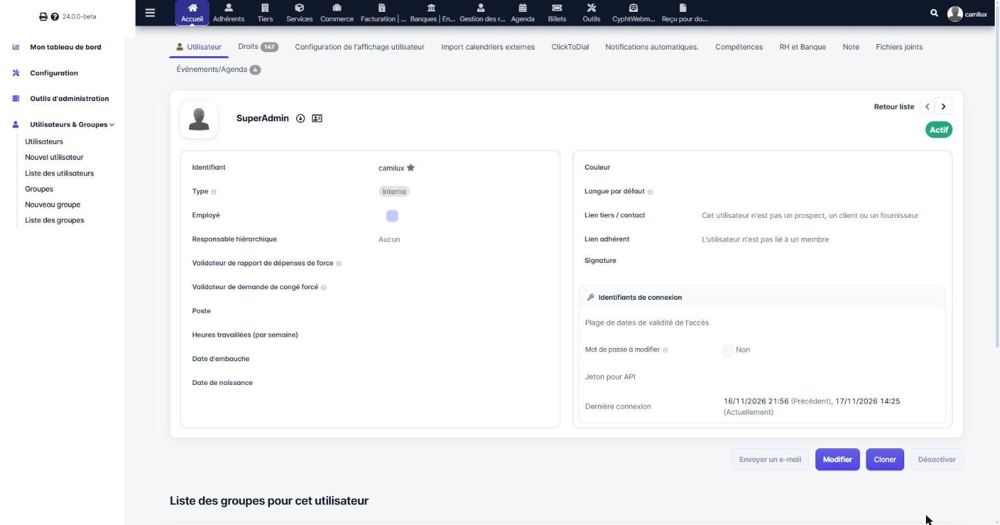 | 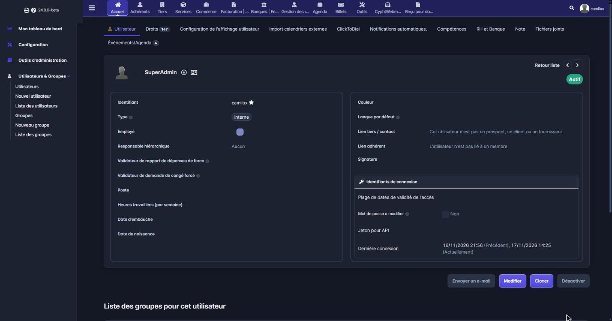 |
| 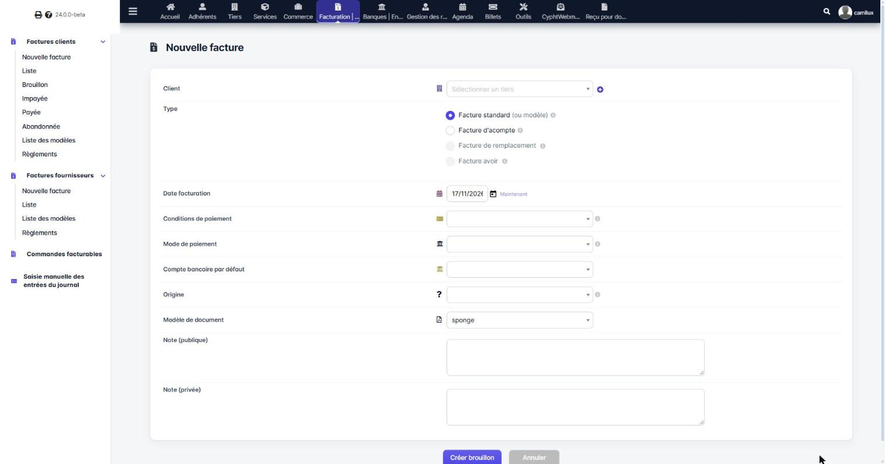 | 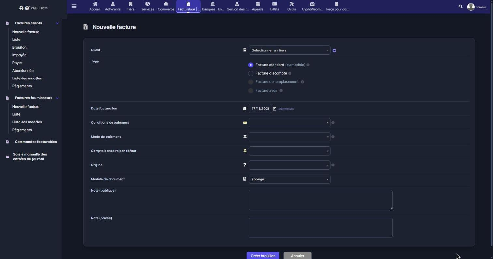 |
| 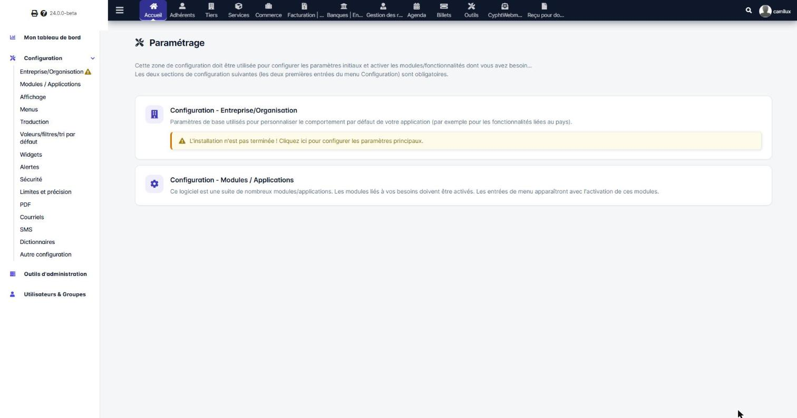 | 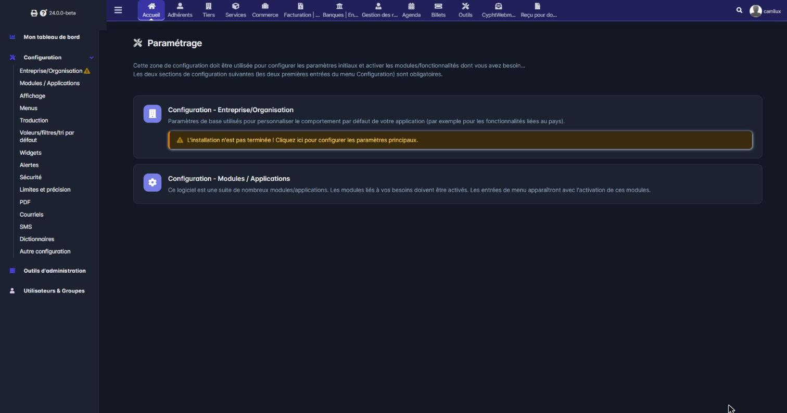 |
| 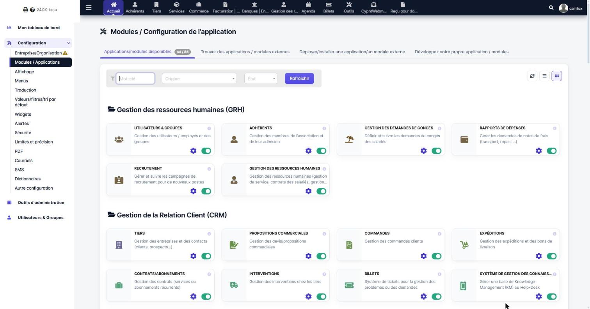 | 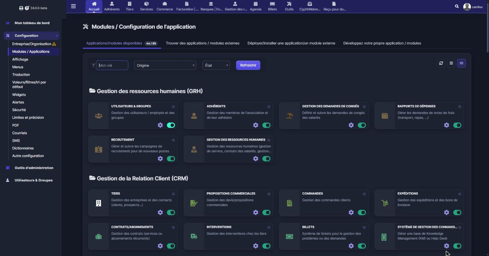 |

## What it changes

- **Palette from the admin settings.** The accent color is derived from the colors set in *Setup > Display > Theme* (top menu background, action button color, link color). Default is indigo.
- **Dark mode.** Follows the standard Dolibarr switch (`THEME_DARKMODEENABLED`): `1` follows the system setting, `2` forces dark. For a quick test add `&THEME_DARKMODEENABLED=2` to any address.
- **Typography.** Inter (variable font, SIL OFL) bundled in `fonts/`, no external request.
- **Tables and lists.** Dark bold headers (600, 700 on the sorted column), soft rows, rounded corners, consistent control height, thin scrollbars.
- **Record view.** Two bordered panels side by side, soft label/value rows, rounded photo or icon tile.
- **Forms.** One standard field width (`--m-field-w`, 340px) and one left edge for every control, with room kept for field icons. Textareas and HTML editors share one width (`--m-area-w`). Modern checkboxes and radios.
- **Tabs.** Dark text, accent underline on the active tab (4px, rounded on top).
- **Left menu.** White panel, clear nesting, solid highlight on the current item and its parent, collapsible groups with chevrons (state kept in the browser).
- **Components.** Tooltips, toasts, dialogs, pagination, badges, buttons, user menu, setup cards.

## Install and enable

1. The theme lives in `htdocs/theme/modern`. Nothing to install.
2. Select it in *Setup > Display > Theme*.
3. To get the left menu highlight and collapsible groups, add the constant `ALLOW_THEME_JS` = `1` in *Setup > Other setup*. Dolibarr then loads `theme/modern/modern.js`. Without it the theme still works, only those two behaviors are off.

Core change: one line in `htdocs/main.inc.php` opens the left menu by default for this theme (`in_array($conf->theme, array('md', 'modern'))`).

## Files

| File | Role |
| --- | --- |
| `style.css.php` | Base sheet (from `md`), includes the two files below at the end |
| `modern.inc.css.php` | Design tokens (`--m-*`), dark mode, tables, buttons, badges |
| `components.inc.css.php` | Tabs, forms, record view, left menu, titles, dropdowns, dark fixes |
| `modern.js` | Current left menu item and collapsible groups |
| `theme_vars.inc.php` | Default colors |
| `fonts/` | Inter and its license |

## Notes

- `style.css.php` is sent with `Cache-Control: no-cache` while the theme is being tuned. Restore a longer `max-age` for production.
- Colors in the theme use CSS variables, so a change in one place (`modern.inc.css.php`) is enough to re-theme it.
- Inter is distributed under the SIL Open Font License, see `fonts/LICENSE.txt`.
